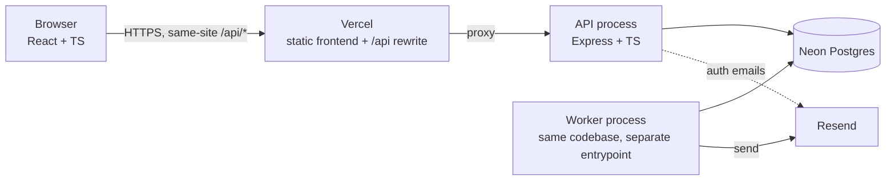
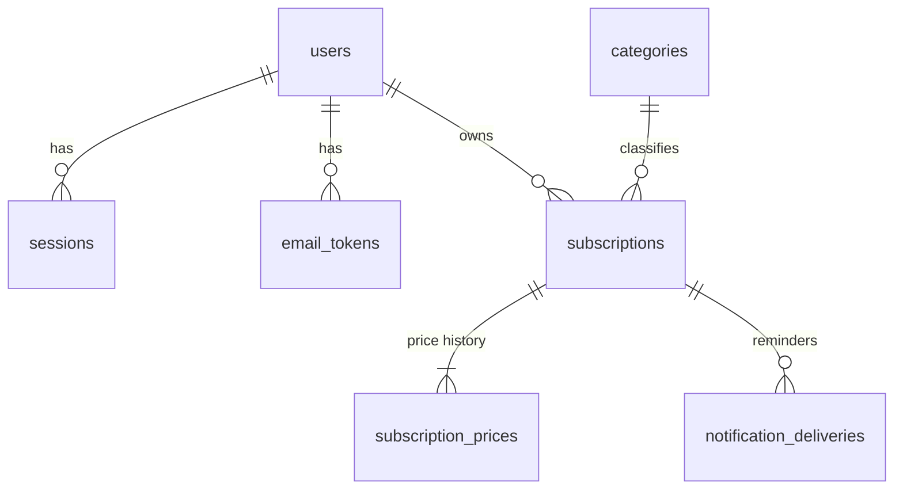
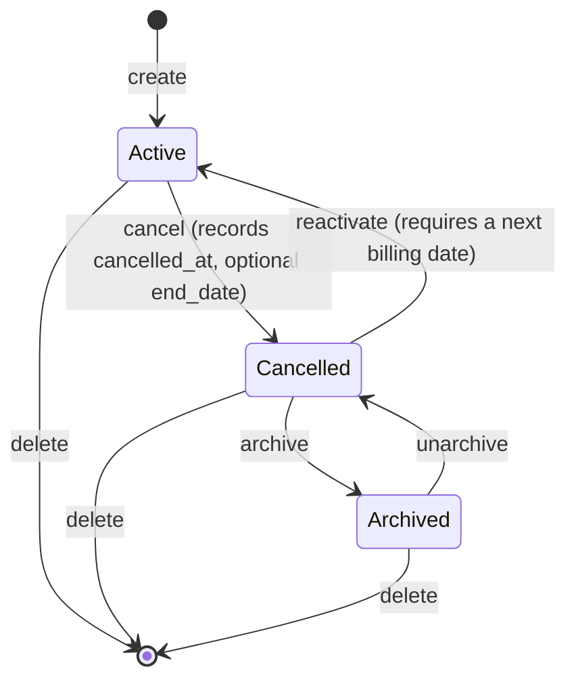
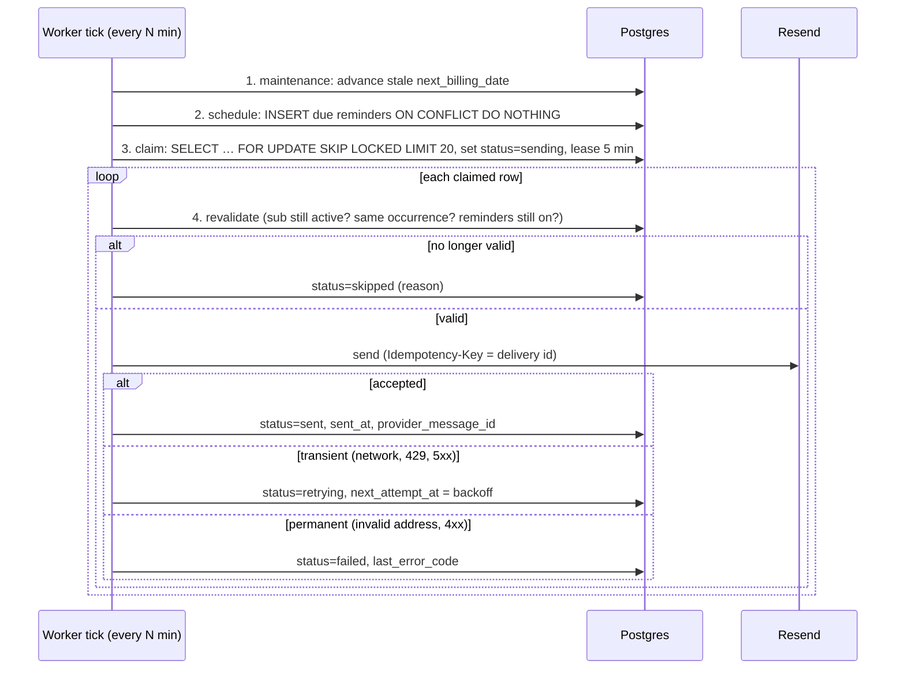

# Subtracker: Architecture and Plan (Phase 1)

Status: **proposal for review** (2026-10-31). Nothing in this document is implemented yet unless it says so.
Requirements source: `forclaude` (the project specification).

---

## 0. Scope assessment

The spec describes a real product with five hard parts. Everything else is ordinary CRUD.

| Hard part          | Why it's hard                                                       | Where it's solved                                     |
| ------------------ | ------------------------------------------------------------------- | ----------------------------------------------------- |
| Recurrence engine  | Month-end dates, leap years, interval changes, timezones            | §4.2, pure module, heavily unit-tested                |
| Money              | Floating point, currency exponents, per-currency totals             | §4.3, integer minor units with one rounding step      |
| Reminders          | Concurrency, retries, crashes, duplicates                           | §6, a Postgres table used as a queue                  |
| Auth and isolation | Sessions, tokens, enumeration, CSRF, ownership checks               | §5                                                    |
| History            | Price changes that take effect in the past, keeping data consistent | §3, price-point table written in the same transaction |

**Estimate:** Phases 2–9 are a few months of part-time work for one developer. Phases 11–12 (forecasting and review suggestions) are optional extensions and shouldn't block a first deploy.

**What exists today:**

- A working JavaScript (ESM) Express app with Drizzle on Neon.
- JWT auth stored in a cookie.
- Monthly/yearly subscriptions.
- A React UI with a warm visual style.

We keep the stack, the folder layout, the UI look and the Drizzle/Neon setup. The rest moves to TypeScript and gets the data model described below.

---

## 1. Architecture



- **One codebase, two entrypoints:** `src/server.ts` (HTTP API) and `src/worker.ts` (scheduler and dispatcher loop). They share the services, the recurrence engine and the database layer. A separate worker process means a slow email provider never slows down API requests, and the worker can be restarted on its own.
- **No Redis or external queue.** Postgres is the queue (§6). One less system to run and explain.
- **Same-site cookies.** Vercel rewrites `/api/*` to the API host, so the browser only ever talks to one origin. The session cookie can stay `SameSite=Lax` and CORS isn't needed in production. With the API on a separate domain we would need `SameSite=None` and stricter CSRF handling.

### Backend layers

```
backend/src/
  server.ts, worker.ts      entrypoints
  app.ts                    express wiring
  config/                   env parsing (zod), constants
  db/                       drizzle schema, client, migrations
  domain/                   PURE logic, no I/O: recurrence, money, lifecycle, reminder rules
  services/                 use cases: DB access + domain logic + transactions
  http/
    routes/                 path to controller mapping, middleware per route
    controllers/            parse input (zod), call a service, shape the response
    middleware/             auth, origin check, rate limit, errors, request logging
    schemas/                zod request/response schemas (also feed OpenAPI)
  jobs/                     scheduler tick, dispatcher tick, email templates
  email/                    EmailSender interface: Resend, Console and Fake implementations
  lib/                      logger, errors, clock
```

Rules:

- Controllers never touch the database or do date math.
- `domain/` never imports the database, Express or the clock. "Now" is always passed in, which makes it fully unit-testable.
- Each service function takes the authenticated `userId` and applies it inside every query (§5.4).

### Technology choices

| Concern             | Choice                                                           | Reason                                                                                                                           |
| ------------------- | ---------------------------------------------------------------- | -------------------------------------------------------------------------------------------------------------------------------- |
| Validation          | **zod**                                                          | One schema validates the request, provides the TypeScript type and generates the OpenAPI docs (`@asteasolutions/zod-to-openapi`) |
| Password hashing    | **Argon2id** (`argon2` package; OWASP params m=19 MiB, t=2, p=1) | Spec preference. Memory-hard, so it's expensive to crack on GPUs                                                                 |
| Logging             | **pino** + `pino-http` with redaction                            | Structured JSON logs; redacts cookies, passwords and tokens                                                                      |
| Rate limiting       | `express-rate-limit`, in-memory store                            | Enough for a single API instance. Limitation documented in §9                                                                    |
| Calendar dates      | Own `PlainDate` module (Y-M-D integers)                          | Small and readable, and avoids the JS `Date` timezone traps. This is the logic the project is meant to showcase                  |
| Timezone conversion | built-in `Intl` (decided in Phase 6; was `@date-fns/tz`)         | Only used to turn "09:00 on date X in zone Z" into an exact moment (handles DST)                                                 |
| Email               | Resend, with a console fallback when `RESEND_API_KEY` is unset   | Decided earlier                                                                                                                  |
| Tests               | Vitest + Supertest against real Postgres                         | Required by the spec; mocks can't check constraints or locking                                                                   |

---

## 2. Data conventions

- **Calendar dates** (billing date, start date, end date, effective date) use Postgres `date`. In TypeScript they're plain `"YYYY-MM-DD"` strings or `PlainDate` objects, never JS `Date`. A billing date is a day on a calendar, not a moment in time.
- **Moments** (created_at, sent_at, expires_at) use `timestamptz` and are stored in UTC.
- **"Today"** always means today in the user's IANA timezone (`users.timezone`). Example: 23:30 in Vancouver on Nov 1 is already Nov 2 in UTC, but the user's "today" is Nov 1.
- **Money** is stored as `amount_minor bigint` plus `currency char(3)`, in integer minor units: USD 15.99 → `1599`, JPY 1500 → `1500`, BHD 1.250 → `1250`.
  - The currency exponent comes from `Intl.NumberFormat(…, {style:'currency', currency}).resolvedOptions().maximumFractionDigits`.
  - The API sends and receives amounts as **decimal strings** (`"15.99"`). The server converts them and rejects too many decimals (`"15.999"` in USD → 400). JavaScript floats are never part of money math.
- **IDs** are `uuid` (`gen_random_uuid()`). Authorization is what protects data, but UUIDs also hide row counts and make IDs hard to guess.

---

## 3. Database schema



### users (current state)

| Column                       | Type                                    | Notes                                                                                     |
| ---------------------------- | --------------------------------------- | ----------------------------------------------------------------------------------------- |
| id                           | uuid PK                                 |                                                                                           |
| email                        | text NOT NULL **UNIQUE**                | normalized (trimmed, lowercased) by the app; `CHECK (email = lower(email))` backs this up |
| password_hash                | text NOT NULL                           | Argon2id encoded string                                                                   |
| timezone                     | text NOT NULL DEFAULT 'UTC'             | IANA name, validated by the app with `Intl`                                               |
| email_verified_at            | timestamptz NULL                        | NULL = unverified; such users can't log in (§5.2)                                         |
| reminders_enabled            | boolean NOT NULL DEFAULT true           | global reminder switch                                                                    |
| default_reminder_days_before | smallint NOT NULL DEFAULT 3, CHECK 0–30 | default for subscriptions set to `default`                                                |
| created_at, updated_at       | timestamptz                             |                                                                                           |

- **Deleted:** hard delete. Every child table uses `ON DELETE CASCADE`, so deleting the account removes all personal data in one statement.
- **Notification preferences:** these live here and on `subscriptions` rather than in a separate `notification_preferences` table with a nullable `subscription_id`. Why: a nullable FK makes "global row vs. per-subscription row" ambiguous, and you need extra partial unique indexes to stop two global rows from existing. Columns make that state impossible.

### sessions (current state)

| Column                          | Notes                                                                                                                        |
| ------------------------------- | ---------------------------------------------------------------------------------------------------------------------------- |
| id text PK                      | **SHA-256 of the session token.** The raw token only ever exists in the cookie, so a leaked database can't be used to log in |
| user_id uuid FK → users CASCADE |                                                                                                                              |
| created_at, expires_at          | 12-hour absolute lifetime from login (no sliding renewal); the cookie's Max-Age matches                                      |

- **Indexes:** `(user_id)` so "log out everywhere" after a password change is fast; `(expires_at)` for the cleanup job.
- **Why server-side sessions instead of JWT:** logout and "invalidate after a password change" become a `DELETE`. A JWT stays valid until it expires.

### email_tokens (scheduled work, short-lived)

One table for both email-verification and password-reset tokens, since they behave the same way.

| Column                                        | Notes                                                                           |
| --------------------------------------------- | ------------------------------------------------------------------------------- |
| id uuid PK                                    |                                                                                 |
| user_id FK CASCADE                            |                                                                                 |
| purpose enum('verify_email','reset_password') |                                                                                 |
| token_hash text UNIQUE                        | SHA-256 of a 32-byte random token. The raw token only appears in the email link |
| expires_at                                    | verification: 24 h; reset: 30 min                                               |
| used_at NULL                                  | single use                                                                      |
| created_at                                    |                                                                                 |

- **Consuming a token** is one atomic statement: `UPDATE … SET used_at = now() WHERE token_hash = $1 AND used_at IS NULL AND expires_at > now() RETURNING user_id`. If two requests use the same token at once, exactly one succeeds.
- **Issuing a new token** marks older unused tokens with the same purpose as used.

### categories (reference data)

- **Columns:** `id smallserial`, `slug text UNIQUE`, `name text`.
- **Contents:** seeded by a migration with Entertainment, Productivity, Health & fitness, Cloud services, Education, Utilities and Other.
- **v1 decision:** a predefined list only. The table can take a nullable `user_id` later if custom categories are wanted. Building that now would mean partial unique indexes and merge rules nobody has asked for yet.

### subscriptions (current state)

| Column                                                                                        | Notes                                                                                                                                                  |
| --------------------------------------------------------------------------------------------- | ------------------------------------------------------------------------------------------------------------------------------------------------------ |
| id uuid PK, user_id FK CASCADE                                                                |                                                                                                                                                        |
| name varchar(100) NOT NULL                                                                    | `CHECK (btrim(name) <> '')`                                                                                                                            |
| category_id smallint FK → categories RESTRICT                                                 |                                                                                                                                                        |
| notes text NULL                                                                               | ≤ 1000 chars, enforced in the app                                                                                                                      |
| amount_minor bigint NOT NULL `CHECK (≥ 0)`, currency char(3) `CHECK (~ '^[A-Z]{3}$')`         | **current** price, a copy of the latest price point (see below)                                                                                        |
| billing_interval enum('week','month','year'), billing_interval_count smallint `CHECK 1–52`    | quarterly = (month, 3), annually = (year, 1). Adding "every 2 weeks" or "every 6 months" needs no code change                                          |
| start_date date                                                                               | when the subscription began (informational, and the lower bound for occurrences)                                                                       |
| billing_anchor_date date                                                                      | **source of truth for the schedule**: one known billing date. All occurrences are computed from it (§4.2). `CHECK (billing_anchor_date >= start_date)` |
| next_billing_date date NULL                                                                   | **materialized cache** computed by the recurrence engine. NULL when no future charge is expected                                                       |
| end_date date NULL                                                                            | fixed end of service. `CHECK (end_date >= start_date)`                                                                                                 |
| status enum('active','cancelled'), cancelled_at timestamptz NULL                              | `CHECK ((status = 'cancelled') = (cancelled_at IS NOT NULL))`                                                                                          |
| archived_at timestamptz NULL                                                                  | `CHECK (archived_at IS NULL OR status = 'cancelled')`: only cancelled subscriptions can be archived                                                    |
| reminder_mode enum('default','custom','off'), reminder_days_before smallint NULL              | `CHECK ((reminder_mode = 'custom') = (reminder_days_before IS NOT NULL))`, 0–30                                                                        |
| payment_method_label varchar(50) NULL, provider_website text NULL, cancellation_url text NULL | free-text labels only. Validation never accepts card numbers or CVVs; URLs must be http(s)                                                             |
| created_at, updated_at                                                                        |                                                                                                                                                        |

**Why store both the anchor and the next billing date?** The anchor is the truth; `next_billing_date` is a cached value.

- Sorting and paginating "by next billing date" in SQL needs a real column.
- Computing it in SQL with month-end clamping would duplicate the recurrence engine.
- So the engine computes it on every write, and the worker's maintenance step moves past dates forward (§6). If the cache is briefly stale (between midnight and the next worker run), the API recomputes the value for any row whose cached date is already in the past.

**Indexes** (chosen for actual query patterns, not added "just in case"):

- `(user_id, next_billing_date)`: subscription list sorting, dashboard "upcoming", calendar.
- Partial `(next_billing_date) WHERE status = 'active'`: the worker's scan across all users.
- No category, name or trigram indexes. A user has tens to hundreds of rows, and the `user_id` prefix already narrows any search to those. We'll check with `EXPLAIN` in Phase 9 instead of guessing.

### subscription_prices (history, append-only)

| Column                                 | Notes                                           |
| -------------------------------------- | ----------------------------------------------- |
| id uuid PK, subscription_id FK CASCADE |                                                 |
| amount_minor bigint, currency char(3)  | the price as of `effective_date`                |
| effective_date date                    | when the price applied **(business time)**      |
| recorded_at timestamptz DEFAULT now()  | when the app learned about it **(system time)** |
| source enum('initial','manual_update') |                                                 |

- **Index:** `(subscription_id, effective_date, recorded_at)`.
- **Price points instead of `old_amount/new_amount` rows (a deliberate change from the spec):**
  - Stored "old" values can disagree with the previous row.
  - A back-dated change inserted between two existing rows would make every later `old_amount` wrong.
  - With points, old → new is derived with `LAG()` over `effective_date`, so it's always consistent.
  - Every subscription gets an `initial` point when it's created.
- **Current price rule (v1):** `effective_date` must be ≤ today, so the current price is the latest point. Writing the point and updating `subscriptions.amount_minor` happen in **one transaction**. Future-dated price changes ("goes up next month") are a later extension.
- **Currency changes:** stored as a point in the new currency. "Increased by X" is only computed between points with the same currency.

### notification_deliveries (scheduled work and delivery log)

This one table is both the job queue and the delivery history, so no separate jobs table is needed.

| Column                                                                             | Notes                                             |
| ---------------------------------------------------------------------------------- | ------------------------------------------------- |
| id uuid PK                                                                         | also used as the email provider's idempotency key |
| subscription_id FK CASCADE                                                         | owner reached through the subscription            |
| kind enum('upcoming_charge')                                                       | room for future reminder types                    |
| billing_date date, days_before smallint                                            | the occurrence this reminder is for               |
| scheduled_for timestamptz                                                          | 09:00 local time on (billing_date − days_before)  |
| status enum('pending','sending','retrying','sent','failed','skipped')              |                                                   |
| attempt_count smallint, next_attempt_at timestamptz, locked_until timestamptz NULL | queue mechanics                                   |
| sent_at, provider_message_id, last_error_code, last_error_message (sanitized)      | visibility for troubleshooting                    |
| created_at, updated_at                                                             |                                                   |

- **`UNIQUE (subscription_id, billing_date, kind)` is the idempotency key:** at most **one logical reminder per charge**, however many times the scheduler runs.
- **Dispatcher index:** partial `(next_attempt_at) WHERE status IN ('pending','retrying','sending')`.
- **On delete:** rows go with their subscription. Privacy wins over keeping an audit trail for deleted data.

---

## 4. Domain rules

### 4.1 Subscription lifecycle



- **Active:** charges are expected. It counts toward totals, the calendar and reminders.
- **Cancelled:** the user _recorded_ that they cancelled. The app does **not** contact the provider. There are no future occurrences or reminders, but it stays visible in lists (with a filter).
- **Archived:** a cancelled subscription hidden from default lists and dashboards. All of its history is kept. In the schema this is the `archived_at` flag rather than a third status value, so unarchiving gets back exactly what was there. The API shows a combined `state: active | cancelled | archived` for display.
- **Delete:** a hard delete including history, behind a confirmation. The UI suggests archiving instead.
- **Archiving an active subscription** returns `409`; cancel it first. This is enforced by a DB constraint as well as the service.

### 4.2 Recurrence engine (`domain/recurrence.ts`, pure)

A schedule is `{ anchor, interval: week | month | year, count, startDate, endDate?, status }`.

**Rule: occurrence k is computed from the anchor, never from the previous occurrence.**

- Weekly: `anchor + 7·count·k days`.
- Monthly: `addMonthsClamped(anchor, count·k)`.
- Yearly: `addMonthsClamped(anchor, 12·count·k)`.

`addMonthsClamped` keeps the anchor's day of the month and clamps it to the last day of shorter months.

| Anchor      | Interval  | Occurrences                                                              |
| ----------- | --------- | ------------------------------------------------------------------------ |
| Jan 31 2026 | monthly   | Feb 28, **Mar 31**, Apr 30, May 31 … (returns to the 31st, never drifts) |
| Feb 29 2028 | yearly    | Feb 28 2029, Feb 28 2030, Feb 28 2031, **Feb 29 2032**                   |
| Nov 30 2026 | quarterly | Feb 28 2027, May 30, Aug 30, Nov 30                                      |
| Any         | never     | adding 30 days                                                           |

**Functions:** `occurrenceAt(schedule, k)`, `nextOnOrAfter(schedule, date)`, `occurrencesBetween(schedule, from, to)`. Range queries compute the first `k` directly instead of looping from the anchor, so a 10-year-old subscription is as fast as a new one.

**Boundaries:**

- **The schedule begins at the anchor** (decided in Phase 3b): no occurrences before it, so no charges are invented between `start_date` and the first billing date the user confirmed. `start_date` stays informational and is the lower bound for the anchor. No occurrences after `end_date` either.
- Cancelled subscriptions have no future occurrences.
- Archived subscriptions are excluded from all aggregates.

**Changing the interval:** if a PATCH changes `billing_interval` or `count`, **`nextBillingDate` is required** (400 without it), and it becomes the new anchor. Example: switching monthly → annually never silently invents a renewal date, because the user confirms it.

**Limitation (documented):** if a user enters Feb 28 as the next billing date for a service that really bills on the 31st, the schedule is anchored to the 28th.

**Past dates** (calendar navigation backwards) show _expected_ charges from the anchor onwards, priced from the price history in effect on that date and labelled "expected, not confirmed".

### 4.3 Money math (`domain/money.ts`)

Payments per year, as an exact fraction: week → 52/count, month → 12/count, year → 1/count.

- Monthly-equivalent of one subscription = `amount_minor × perYear / 12`, kept as an exact fraction using BigInt.
- **Totals add up the exact fractions per currency and round once** (half-up to the currency's minor unit). This avoids "sum of rounded values ≠ rounded sum" drift. Example: three weekly USD 1.00 plans are exactly 13.00/month together, even though each one is 4.333….
- Annualized = `amount_minor × perYear`, rounded once. The UI labels it "estimate based on current prices".
- Weekly uses the spec's 52/12, so it slightly underestimates (a year has ~52.18 weeks). This is documented.
- **No mixed-currency totals.** Every aggregate is grouped by currency.

### 4.4 Reminder rule (`domain/reminders.ts`, pure)

`effectiveDaysBefore(user, sub)`:

- `null` (no reminder) if `!user.reminders_enabled`, the email isn't verified, the subscription is in `off` mode, or it isn't active.
- Otherwise the custom value, or the user's default.

`reminderFor(occurrence)` = `{ billingDate, scheduledFor: zoned(billingDate − days, 09:00, tz) }`. The 09:00 time is a constant; DST gaps are handled by `@date-fns/tz`.

---

## 5. Authentication and security

### 5.1 Sessions

- The cookie `sid` holds a random 32-byte token (base64url) with `HttpOnly; SameSite=Lax; Secure` (in production); `Path=/`.
- The database stores only its SHA-256 hash.
- **Logout** deletes that one session.
- **Password change** deletes all of the user's other sessions and rotates the current one.
- **Password reset and account deletion** delete all sessions.

### 5.2 Flows and enumeration safety

| Endpoint            | Response when the email exists              | Response when it doesn't                                                                                       |
| ------------------- | ------------------------------------------- | -------------------------------------------------------------------------------------------------------------- |
| register            | 202 "Check your email" + verification email | 202 "Check your email" + (if the address is already registered) an "account already exists" email to the owner |
| login               | wrong password → 401 `INVALID_CREDENTIALS`  | 401 `INVALID_CREDENTIALS` (a dummy hash is computed so the timing matches)                                     |
| forgot-password     | 202 + reset email                           | 202                                                                                                            |
| resend-verification | 202                                         | 202                                                                                                            |

- **Unverified accounts can't log in** (`403 EMAIL_NOT_VERIFIED`). This is only returned _after_ a correct password, so it reveals nothing to someone who doesn't know the password.
- **Verifying the email logs the user in.**
- **Auth emails are sent after the HTTP response,** not awaited, with failures logged. The user waits less, response timing doesn't reveal anything, and "resend" covers a lost email. Reminder emails never go out inside an HTTP request (§6).

### 5.3 CSRF

- The cookie is `SameSite=Lax`, so browsers don't send it on cross-site POST/PATCH/DELETE.
- As defence in depth, a middleware rejects state-changing requests whose `Origin` header isn't `APP_ORIGIN`, and requires `Content-Type: application/json` for request bodies.
- No CSRF token is needed with this setup. That holds only while frontend and API stay same-site (Vercel rewrite, §1).

### 5.4 Authorization

- Every subscription query includes `WHERE id = $id AND user_id = $currentUser`. There is no "fetch, then check the owner" step that could be forgotten.
- "Doesn't exist" and "not yours" both return **404**, so other users' IDs can't be probed.
- Child resources (price history, deliveries) are reached through an owned subscription join.
- Integration tests run every endpoint as user B against user A's IDs (§8).

### 5.5 Rate limits (per IP, plus per email where relevant)

- register / login / forgot-password / resend-verification: 5–10 requests per 15 minutes.
- verify-email / reset-password: 10 per 15 minutes.
- The response is 429 with `Retry-After`.

### 5.5b Sign-in with Google

- Server-side OpenID Connect authorization code flow. `GET /api/auth/google/start` stores `state`, `nonce` and a PKCE verifier in an httpOnly cookie scoped to `/api/auth/google` (10 minutes, `SameSite=Lax` so it survives the top-level redirect back) and redirects to Google with the S256 challenge.
- `GET /api/auth/google/callback` clears that cookie first (single use), compares `state` in constant time, exchanges the code with the verifier server-to-server, then checks the ID token's `iss`, `aud`, `exp`, `nonce` and `email_verified`. The signature isn't verified: the token arrived directly from Google's token endpoint over TLS, which OIDC Core §3.1.3.7 accepts.
- Accounts are keyed by Google's `sub` in `auth_identities (provider, subject)`, never by email alone. First sign-in links to an existing account with the same verified email; if that account was never verified, its password and sessions are dropped (pre-account-takeover defence).
- Google-only accounts have `password_hash = NULL`. Password login answers the generic 401 (same timing). They add a password through the reset email, and confirm account deletion by typing their email.
- The redirect URI is `APP_URL/api/auth/google/callback`, through the Vercel rewrite, so the session cookie stays first-party. The callback URL's query (the code) is stripped from request logs.

### 5.6 Logging hygiene

- pino redacts `req.headers.cookie`, `authorization`, `*.password`, `*.token` and `*.newPassword`.
- Emails in logs are reduced to the user id.
- Error responses never include stack traces or SQL.

---

## 6. Reminder pipeline

Approach: **a Postgres table as the queue, plus a polling worker.** Compared with a cron job that sends directly, it adds retries and a delivery record. Compared with Redis/BullMQ, it needs no extra infrastructure, and job state lives in the same database as the data, so it can be updated in the same transactions.



1. **Rows are created only when a reminder becomes due,** not ahead of time.
   - The scheduler finds active subscriptions with `next_billing_date` within the next 31 days.
   - For each upcoming occurrence (there can be several for weekly plans) it computes the reminder time and inserts a row only if `scheduled_for <= now` and the billing date hasn't passed in the user's timezone.
   - **Edits are handled without extra code:** nothing is scheduled in advance, so nothing needs updating when the user changes the price, interval or settings.
2. **Catching up after downtime:** if the worker was down, overdue reminders are still sent as long as the charge date hasn't passed. If it has, they're never sent.
3. **Revalidation right before sending:** the dispatcher recomputes the occurrence from the current data. If a reminder was claimed and the user cancelled the subscription a second later, it's marked `skipped`.
4. **Concurrency:**
   - `FOR UPDATE SKIP LOCKED` lets two worker instances claim different rows and never the same one.
   - The `UNIQUE` key stops two schedulers from creating the same reminder twice.
   - Both work over Neon's pooled connection because each claim is a single transaction. Advisory locks would _not_ work reliably through PgBouncer's transaction pooling.
5. **Retries:**
   - Backoff of 1 min, 5 min, 30 min, 2 h, 6 h (± jitter), with a maximum of 5 attempts, after which the status becomes `failed`.
   - If the provider asks for a delay (`Retry-After`), we wait at least that long.
   - Permanent errors fail immediately.
6. **Crash recovery:** a row stuck in `sending` past `locked_until` can be claimed again.
7. **Delivery guarantee (honest version):**
   - **At most one logical reminder per charge** (DB constraint).
   - **At-least-once send attempts**, with the following crash window: if the worker crashes _after_ Resend accepted the email but _before_ it recorded `sent`, the row is retried.
   - The idempotency key lets the provider drop that duplicate within its dedupe window. Resend's exact idempotency semantics and window will be checked against their docs in Phase 6, not assumed.
   - **Worst case:** occasional duplicate emails. **Never:** silently lost reminders.
8. **Visibility:**
   - Each tick logs counts (scheduled, sent, retried, failed, skipped).
   - `GET /api/notifications` shows users their own delivery log.
   - Failed rows can be found with a single SQL query.
9. **Deployment shape:**
   - The tick logic is plain functions (`runMaintenance(now)`, `runScheduler(now)`, `runDispatcher(now)`).
   - They can run in a long-lived loop (`worker.ts`) or be triggered on a schedule. The trigger is chosen in decision D3.
   - In-memory timers inside serverless functions are never used.
10. **Neon note:** polling keeps the database compute awake (it suspends after ~5 minutes idle). A 10–15 minute tick is precise enough for 09:00 reminders and lets the database sleep between ticks.

---

### Settled in Phase 6

- **Resend facts (checked against their docs):** `Idempotency-Key` header, keys kept for 24 hours; same key + same body returns the original result without sending again. Same key + different body returns `409 invalid_idempotent_request`, which can only mean an earlier attempt was accepted, so the dispatcher records it as **sent**. Retryable: network errors, 5xx, `rate_limit_exceeded`, `daily_quota_exceeded`, `concurrent_idempotent_requests`, `resource_locked`. Everything else fails at once.
- **Retry budget:** 5 attempts with waits of 1 min, 5 min, 30 min, 2 h and 6 h (±20% jitter), about 8.6 h in total, inside the 24-hour idempotency window.
- **Fencing token:** a worker records an outcome only `WHERE status = 'sending' AND attempt_count = <its attempt>`, so a worker that stalled past its 5-minute lease can't overwrite the attempt that replaced it.
- **Settings changes after a reminder is due:** the reminder is still sent if the charge is still on the schedule and reminders are still on. It's skipped (`REMINDERS_OFF`, `SCHEDULE_CHANGED`, `CHARGE_PASSED`) otherwise.
- **Timezones:** "09:00 local" is converted with the built-in `Intl` API (Temporal's "compatible" rules for DST gaps and overlaps), tested on real transitions, so no date library is needed.
- **Trigger:** `POST /api/internal/tick` with `Authorization: Bearer <CRON_SECRET>`, called every 15 minutes by `.github/workflows/reminders.yml`. `npm run worker` runs the same tick in a loop for local development or an always-on host.

### Learned in Phase 8: timezone rules are data

The first CI run failed only on GitHub: its newer Node build ships a newer timezone database in which
British Columbia has moved to permanent daylight time, so `America/Vancouver` stayed at UTC-7 in
November. The app was correct in both places, because it always asks the runtime's database and
never hard-codes offsets. The tests were wrong: they asserted one region's political rules. DST
tests now use zones whose rules aren't in flux (Los Angeles, London) plus fixed-offset zones
(India, Kiribati). In production this means offsets follow whatever database the deployed Node
version ships, so keeping Node patched keeps timezone rules current.

### Phase 9 review

**Security review.** Checked against the spec's list: password hashing (Argon2id), token storage
(SHA-256 hashes, single-use, expiring), session invalidation (logout, password change and reset,
account deletion), enumeration (identical answers and timing), CSRF (SameSite plus Origin and JSON
checks), rate limits (per IP and per email), authorization (owner in every query, tested per
route), input validation (zod at every boundary), logging (secrets redacted), error responses (no
internals). Found and fixed:

| Finding                                         | Risk                                                                               | Fix                                                                |
| ----------------------------------------------- | ---------------------------------------------------------------------------------- | ------------------------------------------------------------------ |
| No `trust proxy` behind Vercel/Render           | every user shares the proxy's rate-limit bucket: one attacker locks out all logins | `TRUST_PROXY` hop count; test proves per-client buckets            |
| No security headers on API responses            | MIME sniffing, framing                                                             | `helmet` (nosniff, frame denial, deny-all CSP, HSTS in production) |
| Oversized bodies returned 500                   | noisy errors, wasted work                                                          | 20 kB JSON limit, mapped to `413 PAYLOAD_TOO_LARGE`                |
| Control characters accepted in names and labels | newlines in email subjects, CSV and logs                                           | rejected in single-line fields; notes keep line breaks             |

Dependency audit: no known vulnerabilities in production dependencies.

**Index review** (`npm run db:explain -w backend`: 2,000 users, 50,000 subscriptions, 68,000 price
points, 144,000 deliveries). Every hot query uses an index: session lookup 0.04 ms (primary keys),
subscription list 0.1 ms (`user_id, next_billing_date`, already sorted), reminder scheduler 1.2 ms
(partial active index), dispatcher claim 0.04 ms (partial claimable index), price history and
reminder history via their leading-column indexes. The two sequential scans are the right choice
(`categories` has 7 rows; the scheduler joins nearly every user). No new indexes were added.

**API documentation:** OpenAPI 3.1 at `/api/docs/openapi.json`, browsable at `/api/docs`. Request
bodies and query parameters are generated from the zod schemas with `z.toJSONSchema`, so the docs
match what the server validates; a test checks every route is documented.

**Deployment:** see [deployment.md](deployment.md). Production migrations run with drizzle-orm's
runtime migrator (`node dist/db/migrate.js`) before the API starts, so the server needs no dev tools.

## 7. API

**Conventions:**

- Every route is under `/api` and uses JSON.
- Success: `{ "data": … }`. Paginated lists: `{ "data": [...], "pagination": { "page", "limit", "total", "totalPages" } }`.
- Errors: `{ "error": { "code": "VALIDATION_ERROR", "message": "…", "details": [{ "path": "amount", "message": "…" }] } }`.
- Status codes: 400 validation · 401 unauthenticated · 403 forbidden/unverified · 404 not found or not owned · 409 conflict/state · 422 business rule · 429 rate-limited · 500 generic message.
- Full per-endpoint documentation (parameters, bodies, errors) is generated as **OpenAPI from the zod schemas** and served at `/api/docs` (Phase 2 onwards).

| Method & path                                                            | Auth | Purpose                                                                                                                    |
| ------------------------------------------------------------------------ | ---- | -------------------------------------------------------------------------------------------------------------------------- |
| GET /api/health                                                          | –    | Liveness check plus a DB ping                                                                                              |
| POST /api/auth/register                                                  | –    | `{email,password}` → 202                                                                                                   |
| POST /api/auth/verify-email                                              | –    | `{token}` → 200 + session                                                                                                  |
| POST /api/auth/resend-verification                                       | –    | `{email}` → 202                                                                                                            |
| POST /api/auth/login                                                     | –    | `{email,password}` → 200 + session                                                                                         |
| POST /api/auth/logout                                                    | ✓    | 204                                                                                                                        |
| POST /api/auth/forgot-password                                           | –    | `{email}` → 202                                                                                                            |
| POST /api/auth/reset-password                                            | –    | `{token,newPassword}` → 204, all sessions revoked                                                                          |
| POST /api/auth/change-password                                           | ✓    | `{currentPassword,newPassword}` → 204                                                                                      |
| GET /api/auth/me                                                         | ✓    | current user                                                                                                               |
| PATCH /api/account                                                       | ✓    | `{timezone}` (email change deferred, see D6)                                                                               |
| DELETE /api/account                                                      | ✓    | `{password}` → 204, cascades everything                                                                                    |
| GET/PATCH /api/notification-preferences                                  | ✓    | `{remindersEnabled, defaultReminderDaysBefore}`                                                                            |
| GET /api/notifications                                                   | ✓    | paginated delivery log                                                                                                     |
| GET /api/categories                                                      | ✓    | predefined list                                                                                                            |
| GET /api/subscriptions                                                   | ✓    | `search, category, state, interval, sort=nextBillingDate\|amount\|name, order, page, limit≤100`                            |
| POST /api/subscriptions                                                  | ✓    | create → 201                                                                                                               |
| GET /api/subscriptions/:id                                               | ✓    | details + next occurrences                                                                                                 |
| PATCH /api/subscriptions/:id                                             | ✓    | partial update. A price change writes a price point in the same transaction; an interval change requires `nextBillingDate` |
| DELETE /api/subscriptions/:id                                            | ✓    | 204                                                                                                                        |
| POST /api/subscriptions/:id/cancel · /reactivate · /archive · /unarchive | ✓    | lifecycle actions (§4.1)                                                                                                   |
| GET /api/subscriptions/:id/history                                       | ✓    | price points with derived old → new                                                                                        |
| GET /api/subscriptions/export                                            | ✓    | CSV download (registered before `/:id`; `:id` must be a UUID)                                                              |
| GET /api/dashboard/summary                                               | ✓    | per currency: active count, monthly equivalent, annualized; upcoming; recent price changes                                 |
| GET /api/dashboard/category-breakdown                                    | ✓    | per currency × category                                                                                                    |
| GET /api/dashboard/spending-trends                                       | ✓    | _recorded_ monthly-equivalent cost over time (from price history), labelled as such                                        |
| GET /api/calendar                                                        | ✓    | `from, to` (≤ 366 days), `subscriptionId?`, `category?` → expected occurrences                                             |
| GET /api/forecast                                                        | ✓    | `range=30d\|90d\|12m` → expected payments by month and currency (Phase 8)                                                  |

- **Sorting by amount** sorts by `(currency, amount_minor)`. Sorting JPY 1500 against USD 15.00 by raw number would be meaningless.
- **CSV export:**
  - RFC 4180 quoting (commas, quotes and newlines).
  - Text starting with `= + - @`, tab or CR gets a leading `'` to prevent spreadsheet formula injection.
  - `Content-Disposition: attachment`.
  - Streamed directly to the response with no temp files, and no internal IDs.

---

## 8. Testing strategy

| Layer            | What                                                                                                                                                                                       | How                                                                                           |
| ---------------- | ------------------------------------------------------------------------------------------------------------------------------------------------------------------------------------------ | --------------------------------------------------------------------------------------------- |
| Unit (`domain/`) | recurrence (month-end, leap years, quarterly, boundaries, interval change), money (exponents, single rounding, per-currency sums), lifecycle transitions, reminder rules                   | Vitest, table-driven cases, no database                                                       |
| Integration      | every endpoint's main flow and validation errors; price change + history in one transaction; CSV escaping                                                                                  | Supertest against a real Postgres; tables truncated between tests; files run sequentially     |
| Security         | each protected route without a cookie (401), with a forged or expired session (401), as another user (404 for read/update/delete); reused or expired tokens; no secrets in responses       | Supertest, plus asserting on captured logs                                                    |
| Worker           | due vs. not-yet-due; cancelled → skipped; **two dispatchers racing on the same rows → one send**; transient → retried; permanent → failed without retry; stale `sending` lease → reclaimed | Tick functions called with an injected clock and a `FakeEmailSender` that can be told to fail |

- **CI:** GitHub Actions runs a Postgres 16 service container.
- **Locally:** tests run against a dedicated Neon `test` branch, or any `TEST_DATABASE_URL`.
- **Rule:** tests never point at the development or production databases.

---

## 9. Deployment and operations

| Piece    | Where                                                                     | Notes                                                          |
| -------- | ------------------------------------------------------------------------- | -------------------------------------------------------------- |
| Frontend | Vercel                                                                    | `vercel.json` rewrites `/api/*` to the API (same-site cookies) |
| API      | Render / Railway / Fly (long-running Node)                                | migrations run as a pre-deploy step with the **unpooled** URL  |
| Worker   | same repo, `node dist/worker.js`                                          | see decision D3                                                |
| Database | Neon: `production` branch for prod, `dev` branch for development          | separate credentials per environment                           |
| CI       | GitHub Actions: lint, typecheck, test (Postgres service), build both apps | deploys through each platform's Git integration once CI passes |

**Health:**

- `GET /api/health` returns 200 only if the database answers.
- The worker logs a heartbeat line every tick; a missing heartbeat means the worker is down.

**Known single-instance limitation:** the in-memory rate limiter allows N × limit requests if the API runs on N instances. The fix, if that ever happens, is a Postgres-backed counter. Not needed at launch.

---

## 10. Risks and edge cases

1. **JS `Date` with calendar dates:** `new Date("2026-01-31")` is UTC midnight, so the date shifts by a day in negative-offset timezones. Mitigation: calendar dates are never turned into `Date` objects (lint rule plus code review).
2. **"Today" depends on the timezone:** next billing dates, reminders and "upcoming" all use the user's timezone. Changing the timezone needs no data migration because everything is computed on the fly.
3. **Reminder lead time longer than the interval** (weekly plan, 10-day reminder): the scheduler looks at every occurrence in the next 31 days, not just the next one.
4. **Changing the interval or anchor:** a new date must be supplied explicitly (§4.2).
5. **Back-dated price changes:** current price = latest effective point, recomputed in the same transaction.
6. **Mixed currencies:** never summed. Sorting by amount is grouped by currency.
7. **Duplicate or missed reminders** after worker crashes or restarts: §6, guarantees stated honestly.
8. **Neon pooled connections:** no session state, prepared-statement assumptions or advisory locks on the pooled URL; migrations use the unpooled one.
9. **Cookies across domains:** solved by the Vercel rewrite. Deploying early (end of Phase 3) catches mistakes here while they're cheap to fix.
10. **Email deliverability:** Resend's test sender only delivers to your own address. Real users need a verified domain (decision D4).
11. **Account deletion while a reminder is being sent:** the FK cascade removes the row, and the worker's update then affects 0 rows, which is treated as skipped.
12. **Neon compute hours:** a frequent worker poll keeps the database awake (§6, item 10).
13. **Scope creep:** forecasting and review suggestions come after a deployed v1.

---

## 11. Roadmap (spec phases with dependency adjustments)

| Phase                  | Deliverable                                                                                                                                                                                    | Adjustment from the spec and why                                                                                                                                                   |
| ---------------------- | ---------------------------------------------------------------------------------------------------------------------------------------------------------------------------------------------- | ---------------------------------------------------------------------------------------------------------------------------------------------------------------------------------- |
| 2 Foundation           | git repo, TypeScript in `backend/` and `frontend/`, npm workspaces, ESLint and Prettier, zod env config, pino, error envelope, Vitest + Supertest, Neon `dev` and `test` branches, CI workflow | The new baseline migration moved to the start of Phase 3 (it ships with the new schema), and the OpenAPI skeleton moved to 3a (it is generated from the zod schemas written there) |
| 3a Auth                | sessions, register/verify/login/logout, forgot/reset/change password, rate limits, origin check, timezone, delete account + tests                                                              | –                                                                                                                                                                                  |
| 3b Subscriptions ✅    | new model, CRUD, lifecycle actions, **paginated list**, ownership tests. **Minimal recurrence engine** (`nextOnOrAfter`). **Price points written from day one**                                | The engine is needed for `next_billing_date`, and history has to be captured before Phase 7 or it's lost                                                                           |
| ↳ Deploy               | first production deploy                                                                                                                                                                        | Moved earlier from Phase 9 so cookie, CORS and hosting problems show up early                                                                                                      |
| 4 Dashboard            | money module + tests, summary, category breakdown, dashboard UI                                                                                                                                | –                                                                                                                                                                                  |
| 5 Calendar             | full recurrence engine (`occurrencesBetween`), calendar API and UI, filters                                                                                                                    | –                                                                                                                                                                                  |
| 6 Notifications        | preferences, worker (maintenance, scheduler, dispatcher), templates, retries, delivery log + failure tests                                                                                     | –                                                                                                                                                                                  |
| 7 History and data     | history API and UI, search/filter/sort completed, CSV export                                                                                                                                   | –                                                                                                                                                                                  |
| 8 Forecast             | forecast API and chart                                                                                                                                                                         | –                                                                                                                                                                                  |
| 9 Production readiness | security, validation and index review (EXPLAIN), README, API docs, final end-to-end check in production                                                                                        | –                                                                                                                                                                                  |
| 12 (optional)          | rule-based review suggestions                                                                                                                                                                  | –                                                                                                                                                                                  |

---

## 12. Deviations from the spec (all intentional)

1. **Archived** is a flag on cancelled subscriptions, not a third status value (§4.1), so the "cancelled" fact survives archiving.
2. **Price history** is stored as price points with old → new derived (§3), so no redundant data can drift out of sync.
3. **Notification preferences** live in columns on `users` and `subscriptions`, not a table with a nullable FK (§3).
4. **No separate job table:** `notification_deliveries` is the queue (§3, §6).
5. **Both an anchor date and a cached `next_billing_date`** (§3).
6. **Phone or SMS reminders** (added earlier) are not in the spec. Proposed for removal (D5).
7. **Auth emails are sent outside the request, without a queue** (§5.2). A full outbox would be over-engineering for v1.

## 13. Decisions (made 2026-10-31)

| #   | Decision                       | Outcome                                                                                                                                                                                                                          |
| --- | ------------------------------ | -------------------------------------------------------------------------------------------------------------------------------------------------------------------------------------------------------------------------------- |
| D1  | Reset the Neon schema and data | **Yes**, at the start of Phase 3 when the new schema lands (the old data is test-level)                                                                                                                                          |
| D2  | TypeScript conversion          | **In place** in `backend/` and `frontend/` (done in Phase 2)                                                                                                                                                                     |
| D3  | Where the reminder worker runs | **GitHub Actions cron** calls a protected `POST /internal/tick` every 15 min (free). `npm run worker` runs the same tick functions in a loop for local development. Moving to an always-on worker later changes only the trigger |
| D4  | Email sending                  | Console fallback until a domain is verified in Resend                                                                                                                                                                            |
| D5  | Phone/SMS reminders            | **Removed** in Phase 3 with the new subscription model                                                                                                                                                                           |
| D6  | Email-address changes          | **Deferred** past v1                                                                                                                                                                                                             |
| D7  | Google sign-in                 | **Added** after Phase 9: server-side OIDC code flow with PKCE (§5.5b), optional via `GOOGLE_CLIENT_ID`/`GOOGLE_CLIENT_SECRET`                                                                                                    |
